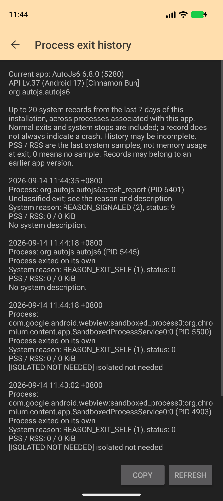
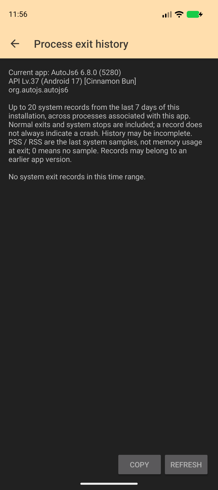
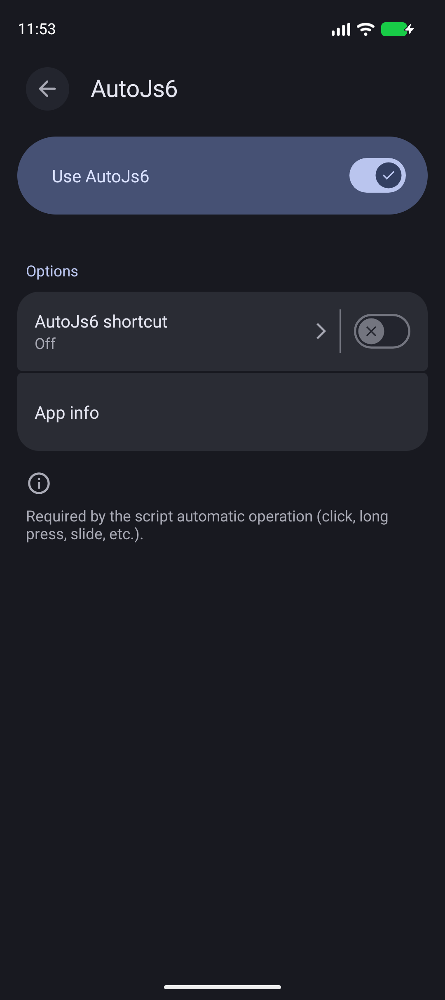

# SDK 37 P2.13 / P2.14: 进程退出报告与高级保护环境对照

日期: 2026-09-14. 源码起点 `de4bc5347`, 生产功能提交 `25d34694e`. 本轮实现 P2.13 的用户报告入口,
并完成 P2.14 在现有镜像上的开启 / 关闭与重新绑定对照.
[机器结果、APK 摘要和原始材料索引](android-sdk-37-p213-p214-results-20260914.json).

## 1. 生产功能

设置页的 "关于" 分类增加 "进程退出记录". Android 11+ 在用户打开或刷新页面时,
通过 `ActivityManager.getHistoricalProcessExitReasons(packageName, 0, 20)` 读取系统历史.
旧系统显示版本要求, 查询失败与空历史分别显示. 查询运行在 IO dispatcher,
协程随 Activity 销毁取消; 不在 Application 启动时读取或弹窗.

- [ProcessExitHistory.kt](../../../app/src/main/java/org/autojs/autojs/tool/ProcessExitHistory.kt):
  最多 20 条, 限定当前安装以来最近 7 天, 丢弃无效 / 未来时间; 按时间排序,
  以 timestamp + processName + PID 去重, 保留 PID 复用和同时间的不同进程.
- [ProcessExitHistoryActivity.kt](../../../app/src/main/java/org/autojs/autojs/ui/error/ProcessExitHistoryActivity.kt):
  显示当前应用版本、系统、记录时间与时区、进程、PID、原始 reason / status、PSS / RSS
  及系统描述, 支持刷新与复制. 每条描述最多显示 4096 字符, 分类使用完整描述.
  明确标注版本为当前应用版本, 历史记录可能属于较早版本.
- 正常自行退出、用户停止、权限 / 包状态改变等记录保留, 不一律解释为崩溃.
  仅 `REASON_OTHER` 且描述包含 `MemoryLimiter:AnonSwap` 时给出该限制器标签.
  未知原因保留数字和原文, `SIGKILL` / LMKD / Java OOM 不冒充限制器命中.
- 页面只响应用户操作, 刷新替换整个快照; 不会因重复打开而累计记录或反复自动提示.
  Activity 为 `exported=false`, 与已有 Java 崩溃页分开, 返回不会退出整个应用.
- 17 项文案覆盖 10 种语言 / 11 个资源目录, 默认与 values-en 一致;
  v6.8.0 changelog 已更新并运行 Markdown 生成器. 未修改公开脚本 API 或插件契约.

[ActivityManager 官方 API](https://developer.android.com/reference/android/app/ActivityManager#getHistoricalProcessExitReasons(java.lang.String,%20int,%20int))
说明历史是有界环形缓冲区, 还可能包含关联的外部服务进程.
[ApplicationExitInfo 官方 API](https://developer.android.com/reference/android/app/ApplicationExitInfo)
说明 PSS / RSS 是最后一次系统采样, 0 表示未取得样本; 不能作为退出瞬间的准确用量.
本轮已实际看到关联的 WebView sandbox 进程, 因此没有按宿主进程名前缀错误过滤.

## 2. 设备验证

仅操作独占只读 `AVD_API_37`, serial `emulator-5596`, 私有 adb server 5058,
RAM 4096 MiB. 指纹:
`google/sdk_gphone16k_x86_64/emu64xa16k:17/CE2A.260420.019/15611780:userdebug/dev-keys`.
`getconf PAGE_SIZE` 为 16384, 实际内核页仍为 4096, 不计真实 16 KB 测试.

| 验证 | target 36 | target 37 |
| --- | --- | --- |
| 滚动设置列表并实际点击入口 | 通过 | 通过 |
| 完整报告复制到剪贴板, 刷新不重复累计 | 通过 | 通过 |
| Activity 重建后报告和复制按钮可用 | 通过 | 通过 |
| 进程 `System.exit(0)` 后恢复查看 `REASON_EXIT_SELF`, status 0 | PID 5445 | PID 7068 |
| 独立 `:crash_report` 进程被测试发送 signal 9 后显示 `REASON_SIGNALED`, status 9 | PID 6401 | PID 7963 |
| 手动停止后显示 `REASON_USER_REQUESTED`, 未标为内存限制器 | PID 5980 | PID 7553 |

两组各保存 6 个页面检查点, 共 12/12. 每个阶段保留完整报告、窗口焦点与系统
`dumpsys activity exit-info`, 对照上述 PID 和退出原因. `:crash_report` 的 signal 9
是测试注入, 不称为真实应用崩溃或内存压力.

另在独占克隆上全新安装最终正常包, 确认空历史提示、复制、刷新与页面重建,
3/3 检查点通过. 没有清理原始 AVD 或实体设备应用数据.
首个 target 36 尝试仅因 `uiautomator dump /dev/tty` 不返回 XML 而失败,
改用独立临时 XML 文件后通过; 失败回执也保留在机器结果索引中.

## 3. P2.13 仍开放的验收

两个 target 的 `am memory-limiter status` 均为 `disabled`.
本轮没有修改 DeviceConfig / 全局限制、运行大图 / OCR / Node 内存压力或改变时钟.
分类单元测试中的限制器描述属于夹具, 不替代真实终止记录.

[Android 17 官方行为说明](https://developer.android.com/about/versions/17/behavior-changes-all#app-memory-limits)
目前给出的判据仍为 OTHER + `MemoryLimiter:AnonSwap`.
在线 ApplicationExitInfo 文档另已列出 37.2 的 `REASON_MEMORY_LIMITER`, 本地 37.0 SDK
尚无该常量; 新平台原因保留数字, 后续使用对应 SDK / 镜像时再核对分类.

必须在实际启用限制器的 API 37 镜像 / 设备上运行有界、可取消的代表负载,
保存输入规模、PID、采样及历史报告, 才能关闭内存压力与限制器报告验收.
旧系统不支持页面、系统服务查询失败、OEM 历史保留策略尚未做设备验证.

## 4. P2.14 的实测边界

[Google 2026-05-12 官方说明](https://blog.google/security/whats-new-in-android-security-privacy-2026/)
明确提到 Android 17 高级保护会限制未标记为辅助工具的无障碍服务, 不再只依赖二手来源.
但本机镜像开启后的实际行为与该目标规则有差异.

对 target 36 / 37 分别执行以下流程, 共 16 个系统状态快照:

1. 保存初始值: protection=false, enabled services=null, 无绑定.
2. 启用宿主无障碍服务, 确认系统 Bound services 包含 AutoJs6.
3. `cmd advanced_protection set-protection-enabled true`, 确认 mode=true.
4. 从标准无障碍设置进入 Downloaded apps / AutoJs6, 保存 UI XML 与截图.
5. 在保护开启期间先移除启用项, 确认解绑, 再重新启用并观察绑定.
6. 关闭保护, 再次查看设置 / 绑定, 最后恢复原始启用项和 accessibility_enabled 值.

两组开启保护后均保持绑定; 保护开启期间的解绑与再次绑定也成功.
设置页仍显示启用的 "Use AutoJs6", 未出现高级保护拒绝文案.
`dumpsys user` 在全部状态中均没有 `no_non_tool_accessibility_service`,
但模式开启时有 `no_cellular_2g` 与 `no_install_unknown_sources_globally`.
`dumpsys advanced_protection` 同时列出 AccessibilityServiceAdvancedProtectionProvider.
这些观察不构成 "Android 17 高级保护不限制 AutoJs6" 的普遍结论.

前次提取的 CE2A.260420.019 services.jar 字节码中的
`AccessibilityManagerService.handleAdvancedProtectionModeStateChanged(List)`
根据具体 feature 的 `isEnabled()` 添加 / 清除该 user restriction,
不是直接以全局 mode boolean 代替 feature 状态. 本次源码核对复用既存字节码,
没有重新拉取当前 system jar 做同源哈希比对. 本轮未强行修改 feature provisioning
或非公开开关, 未推定当前 feature 不生效的根因.

直接通过 shell 启动 ACCESSIBILITY_DETAILS_SETTINGS 曾被
OPEN_ACCESSIBILITY_DETAILS_SETTINGS 权限拒绝; 最终流程使用标准设置入口,
不把这个测试入口问题误判为宿主无障碍权限失败.

[AdvancedProtectionManager 官方 API](https://developer.android.com/reference/android/security/advancedprotection/AdvancedProtectionManager)
和[接入指南](https://developer.android.com/privacy-and-security/advanced-protection-mode)
要求 SDK >= 36 及声明 QUERY_ADVANCED_PROTECTION_MODE. 后续若实现提示, 还需区分
Android 16 的全局模式与 Android 17 的具体限制, 避免给其他启用失败错误归因.
本轮没有实现未经实测验证的失败归因, 没有声明 isAccessibilityTool, 也没有改变 Q5.
P2.14 的真实撤销 / 拒绝、失败路径提示和文档 FAQ 仍待可复现环境.

## 5. 构建与收尾

- 新增 JVM 测试 12/12: 双字段限制器判据、普通退出、崩溃 / ANR / LMKD,
  未知原因、时间边界、安装边界、记录上限、去重、多进程与 PID 复用、重复刷新.
- 正常宿主 target 36 / inrt target 29 及覆盖 target 37 的两个 debug APK 均构建成功.
  最后恢复正常构建并执行 app / inrt release 主 manifest 合并.
  版本仍为 6.8.0 (5280), compileSdk 37; 本轮没有执行完整 release / R8.
- 资源 XML、格式参数、插入顺序、标点、默认 / 英文一致性和 `git diff --check` 已核对.
  额外全量 `:app:lintAppDebug` 运行约 19 分 50 秒后仍在 `lintAnalyzeAppDebug`,
  未生成本轮报告, 已取消; Gradle 日志确认收到客户端断开并取消构建.
  此项标为未完成, 不引用 2026-09-13 的旧报告, 不宣称本轮 Lint 通过.
- 私有 adb 与只读 AVD 已按 PID / 启动时间核对后关闭, 最终仅剩原共享 adb 31400,
  启动时间未变. 没有操作手机, 没有建立调试会话或改变用户断点.

原始材料位于 `build/sdk37-p213-20260914/`, 包含冻结 APK、运行回执、系统记录、
截图、构建日志与清理记录. 需要实体机的项目继续集中执行, 本轮不要求维护者立即操作.
